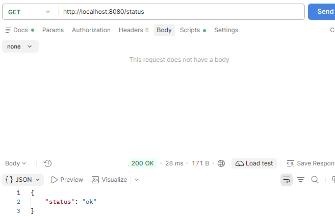
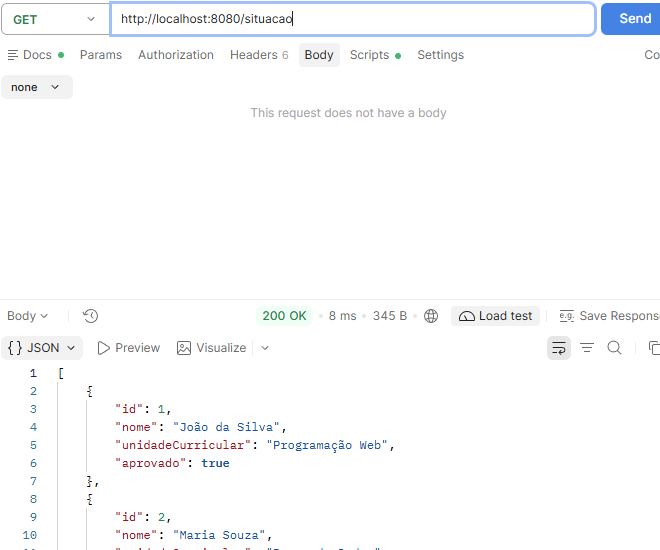
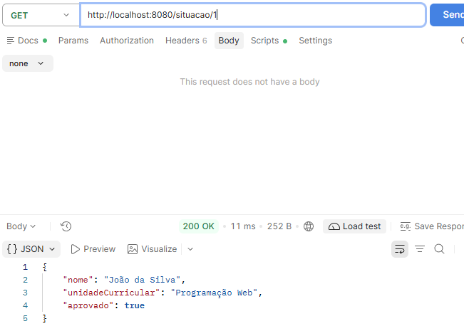
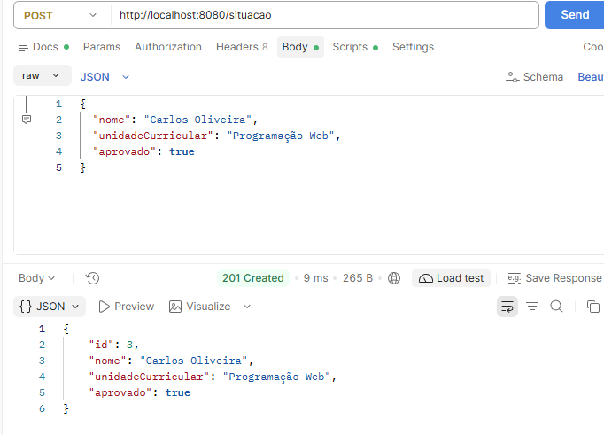
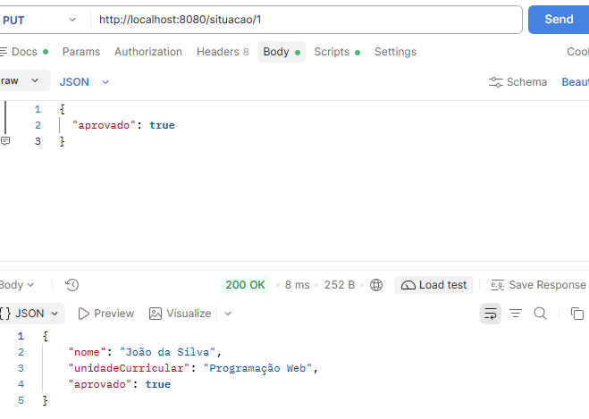
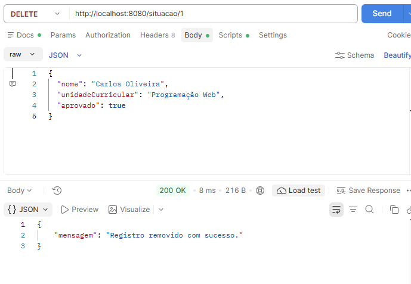

# Situação Acadêmica

Aluna: Luiza Vittória Cardoso
Turma: 2 INFO

## 1. O que precisa

- PHP 7.4 ou superior

## 2. Iniciar a API

Abra um terminal na pasta do projeto e execute:

```sh
php -S localhost:8080 -t public public/index.php
```

A API estará disponível em `http://localhost:8080`. Deixe o terminal aberto enquanto usa a API. Para parar o servidor, pressione `Ctrl+C`.

As situações iniciais são João da Silva (ID 1) e Maria Souza (ID 2). Os dados são salvos no arquivo `src/situacoes.json` quando uma situação é cadastrada, atualizada ou removida.

## 3. Executar os testes

Na pasta do projeto, execute:

```sh
php testes/testesAcademia.php
```

Não é necessário iniciar a API. O teste usa um arquivo temporário e não altera os dados do servidor. Quando tudo funciona, mostra:

```text
Todos os testes passaram.
```

## Endpoints disponíveis

Requisições com dados devem estar em JSON e usar o cabeçalho `Content-Type: application/json`. As respostas, inclusive as de erro, também são JSON.

| Método | Endereço | O que faz |
| --- | --- | --- |
| GET | `/status` | Verifica se a API está funcionando. |
| POST | `/situacao` | Cadastra uma situação com `nome`, `unidadeCurricular` e `aprovado`. |
| GET | `/situacao` | Lista as situações cadastradas. |
| GET | `/situacao/{id}` | Consulta uma situação pelo ID. |
| PUT | `/situacao/{id}` | Altera somente o campo `aprovado`. |
| DELETE | `/situacao/{id}` | Remove a situação. |

Use `GET /situacao` para listar todos os registros ou `GET /situacao/1` para consultar o registro de ID 1.

O campo `aprovado` deve ser `true` ou `false`. O `PUT` deve receber somente esse campo. Exemplo:

```json
{"aprovado":false}
```

Ao cadastrar, a API retorna `201`. Consultas, atualizações e exclusões feitas com sucesso retornam `200`. Dados inválidos retornam `400`; um ID que não existe retorna `404` com a mensagem `Estudante não encontrado.`.

## Evidências de testes

As imagens abaixo mostram as requisições feitas no Postman e as respostas da API.

### Verificação da API — `GET /status`



### Listagem — `GET /situacao`

O resultado mostra as duas situações iniciais.



### Consulta por ID — `GET /situacao/1`



### Cadastro — `POST /situacao`



### Atualização — `PUT /situacao/1`

O corpo da requisição contém somente o campo `aprovado`.



### Exclusão — `DELETE /situacao/1`



Os testes automatizados também confirmam que, depois da exclusão, o ID removido retorna `404`.


